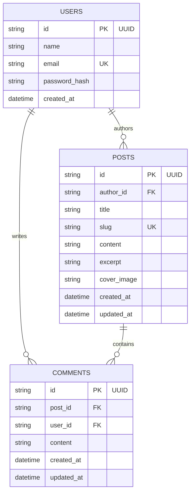

# DevBlog – Full-Stack Blog Platform with Comments

[](https://fastapi.tiangolo.com/)
[](https://react.dev/)
[](https://www.typescriptlang.org/)
[](https://www.postgresql.org/)
[](https://tailwindcss.com/)

DevBlog is a modern, high-performance, full-stack blogging platform built for technical authors and developers. Registered users can write, edit, and delete markdown-rich technical articles, engage in post discussions via comments, and explore dedicated author profile pages.

Developed for **Thiranex Internship Task 4**.

---

## 🚀 Key Features

- **User Authentication & Session Management**:
  - Secure Registration & Login with Bcrypt password hashing.
  - Stateless JWT token authentication with user payload verification.
  - `/api/auth/me` current user profile fetch.

- **Blog Article Management (CRUD)**:
  - Create, read, edit, and delete technical articles.
  - Auto-generated URL-safe slugs (`/posts/mastering-fastapi-react`).
  - Safe Markdown renderer (`react-markdown`) with support for code blocks, tables, blockquotes, and lists.
  - Strict ownership validation: Backend enforces that users cannot edit or delete other users' posts.

- **Interactive Comments Section**:
  - Authenticated users can leave comments on any article.
  - Inline comment editing and deletion with ownership checks.
  - Display author details, creation timestamp, and owner action buttons.

- **Search & Topic Filtering**:
  - Live article search across titles, Markdown content, and author names (`GET /api/posts?search=`).
  - Interactive topic filter badges (`FastAPI`, `React`, `PostgreSQL`, `TypeScript`, `Architecture`).

- **Author Profiles & Dashboard**:
  - Author profile pages (`/authors/:id`) showcasing published article count and post history.
  - User Dashboard (`/dashboard`) providing article management table, stats summary, and creation shortcuts.

---

## 🛠️ Tech Stack

### Frontend
- **Framework**: React 19 (Vite)
- **Language**: TypeScript
- **Styling**: Tailwind CSS v4
- **Routing**: React Router DOM v7
- **HTTP Client**: Axios with JWT Bearer Interceptors
- **Icons & Markdown**: Lucide React, React Markdown

### Backend
- **Framework**: Python FastAPI
- **Database**: PostgreSQL (with automatic zero-setup SQLite fallback)
- **ORM**: SQLAlchemy 2.0
- **Validation**: Pydantic v2 & Email Validator
- **Security**: PyJWT, Pure Bcrypt Password Hashing

---

## 🗄️ Database Schema & Relationships



---

## 📡 API Endpoints Reference

### Auth Endpoints
| Method | Endpoint | Access | Description |
| :--- | :--- | :--- | :--- |
| `POST` | `/api/auth/register` | Public | Register new user account |
| `POST` | `/api/auth/login` | Public | Authenticate user & return JWT token |
| `GET` | `/api/auth/me` | Authenticated | Get current logged-in user profile |

### Post Endpoints
| Method | Endpoint | Access | Description |
| :--- | :--- | :--- | :--- |
| `GET` | `/api/posts` | Public | List all articles (supports `?search=`) |
| `GET` | `/api/posts/{id}` | Public | Get post detail (by ID or slug) with comments |
| `GET` | `/api/posts/my-posts` | Authenticated | Get posts written by current user |
| `POST` | `/api/posts` | Authenticated | Create a new blog post |
| `PUT` | `/api/posts/{id}` | Authenticated | Edit post (Ownership verified) |
| `DELETE` | `/api/posts/{id}` | Authenticated | Delete post (Ownership verified) |

### Comment Endpoints
| Method | Endpoint | Access | Description |
| :--- | :--- | :--- | :--- |
| `GET` | `/api/posts/{post_id}/comments` | Public | List comments for a post |
| `POST` | `/api/posts/{post_id}/comments` | Authenticated | Add a comment to a post |
| `PUT` | `/api/comments/{comment_id}` | Authenticated | Edit comment (Ownership verified) |
| `DELETE` | `/api/comments/{comment_id}` | Authenticated | Delete comment (Ownership verified) |

### Author Endpoints
| Method | Endpoint | Access | Description |
| :--- | :--- | :--- | :--- |
| `GET` | `/api/authors/{author_id}` | Public | Get author bio & total posts count |
| `GET` | `/api/authors/{author_id}/posts` | Public | Get articles published by author |

---

## ⚡ Quick Start Guide

### Prerequisites
- Python 3.10+
- Node.js 18+ and npm
- PostgreSQL (Optional, zero-config SQLite fallback is enabled)

### 1. Backend Setup
```bash
# Navigate to backend directory
cd backend

# Create virtual environment
python -m venv venv

# Activate virtual environment
# Windows:
.\venv\Scripts\activate
# Linux/macOS:
source venv/bin/activate

# Install dependencies
pip install -r requirements.txt --no-binary sqlalchemy

# Start FastAPI development server (seeds sample posts automatically)
uvicorn app.main:app --reload --port 8000
```
Backend API will run at `http://localhost:8000` (Interactive Swagger docs at `http://localhost:8000/docs`).

### 2. Frontend Setup
```bash
# Navigate to frontend directory
cd frontend

# Install Node dependencies
npm install

# Start Vite development server
npm run dev
```
Frontend application will run at `http://localhost:5173`.

---

## 🧪 Testing

### Running Backend Pytest Integration Suite
```bash
cd backend
.\venv\Scripts\python -m pytest -v
```
Verifies registration, login, post CRUD, comment CRUD, author endpoints, and ownership authorization.

### Running Frontend Build Verification
```bash
cd frontend
npm run build
```
Validates TypeScript compilation and generates production assets in `frontend/dist`.

---

## 🔑 Pre-seeded Demo Accounts

| User | Email | Password | Role |
| :--- | :--- | :--- | :--- |
| Alex Chen | `alex@devblog.com` | `password123` | Senior Engineer Author |
| Sarah Jenkins | `sarah@devblog.com` | `password123` | Cloud Architect Author |

---

## 📋 Thiranex Internship Task 4 Submission Checklist

- [x] User registration, login, logout, and JWT authentication
- [x] Create, read, edit, and delete blog posts
- [x] Full comment section under articles (create, edit, delete comments)
- [x] RESTful API endpoints matching specifications
- [x] Database integration (PostgreSQL with SQLite fallback)
- [x] Content management & safe Markdown rendering
- [x] Strict ownership validation on backend (users cannot edit/delete others' posts or comments)
- [x] Author profile pages (`/authors/:id`)
- [x] Live article search & topic filtering
- [x] Creator dashboard (`/dashboard`)
- [x] Production build verification (`npm run build`)
- [x] Comprehensive integration test suite passing cleanly
